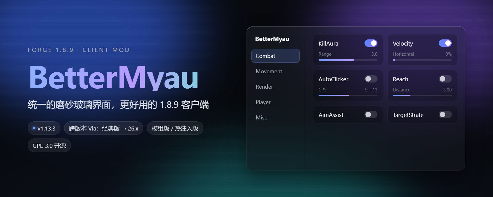
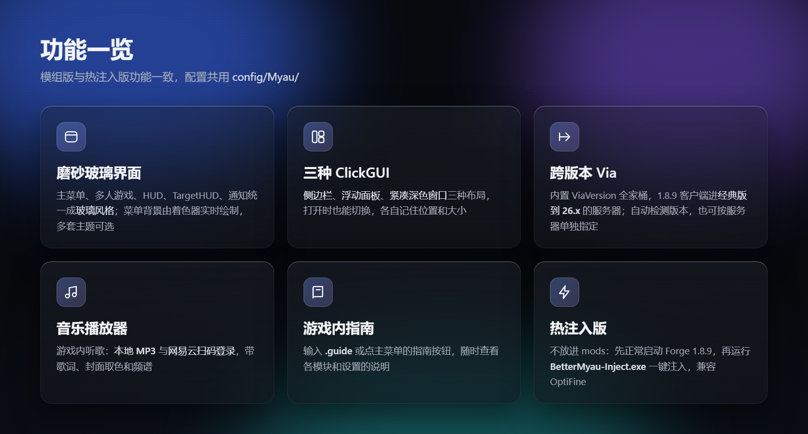

# BetterMyau



BetterMyau 是基于 [OpenMyau](https://github.com/60124808866/OpenMyau)（`Myau-250910`）继续开发的 Minecraft **Forge 1.8.9** 客户端模组，
在原版功能之上加入了统一的磨砂玻璃界面、跨版本 Via、音乐播放器、游戏内指南等大量改动。

- **模组版**：放进 `mods` 文件夹，随游戏启动
- **热注入版**：先正常启动游戏，再一键注入，见 [BetterMyau-Inject](https://github.com/CuteEthanLeo/BetterMyau-Inject)

模组版与注入版共用同一个版本号、同一份源码（本仓库）。

## 下载与安装

到 [Releases](https://github.com/CuteEthanLeo/BetterMyau/releases) 下载最新的 `BetterMyau-1.8.9-vX.Y.Z.jar`：

1. 安装 Forge 1.8.9（可同时装 OptiFine）
2. 把 jar 放进该版本的 `.minecraft/mods/`
3. 启动游戏；配置保存在 `.minecraft/config/Myau/`

## 主要特性



- **磨砂玻璃 UI**：主菜单、各界面、HUD、TargetHUD、通知统一成玻璃风格；主菜单与菜单背景由代码绘制
  （`myau.ui.glass.MenuBackdrop`，HUD 的 `menu-background` 设置：AURORA 流光 / NIGHT 方块夜景 / PANORAMA 模糊全景 / MINIMAL 纯黑），不需要额外素材
- **三种 ClickGUI 布局**（ClickGui 模块的 `style`，打开时也能切换）：SIDEBAR（左侧分类、右侧模块卡片）、
  PANELS（每个分类一个浮动面板）、AUGUSTUS（紧凑深色窗口）；各自的位置大小保存在 `config/Myau/clickgui-*.json`
- **跨版本 Via**（1.13.0 起）：内置 ViaVersion / ViaBackwards / ViaRewind / ViaLegacy / ViaAprilFools，
  1.8.9 客户端可以进经典版到 26.x 的服务器；默认先 ping 服务器自动判断版本，也可全局或按服务器指定（`config/Myau/via.json`）。
  装了 ViaForge 时内置 Via 自动停用
- **游戏内指南**（`.guide` 或主菜单的指南按钮），文章在 `assets/minecraft/bettermyau/guide/zh_cn.txt`
- **音乐播放器**：支持本地 MP3 与网易云扫码登录
- **KillAura 的 ML 转头模式**（`myau.ml.MLAim`）：用 DataCollector 模块录制自己的瞄准数据（`config/Myau/CollectData/`），
  执行 `.ml train` 调用内置脚本训练（需要 Python 3 + `numpy` + `torch`），模型写到 `config/Myau/ML/` 后立即生效；
  没有模型时只做平滑转向

## 从源码构建

需要 JDK 17 或 21 来运行 Gradle 8.8（不支持 Java 25），编译用的 Java 8 工具链由 Gradle 自动下载。
首次构建需要联网（Via 相关依赖来自 `repo.viaversion.com` 与 Maven Central）。

```bash
./gradlew remapJar
```

产物在 `build/libs/`，文件名形如 `BetterMyau-1.8.9-v<版本>.jar`。Windows 上装了多个 JDK 时先指定一个：

```powershell
$env:JAVA_HOME = "C:\Program Files\Java\jdk-21"
```

开发时可用 `./gradlew runClient` 启动游戏（Gradle 同样用 JDK 17/21 运行；`build.gradle.kts` 为 Gradle 8 重新注册了
`runClient`，游戏跑在 Java 8 工具链上）。

### 目录说明

| 目录 | 内容 |
|---|---|
| `src/main/java/myau/` | 模组本体（模块、界面、Mixin、Via、音乐、ML 等） |
| `src/main/java/myau/inject/` | 注入版的运行时部分（Agent、晚启动的 Mixin 引擎、类重定义） |
| `src/injectBuild/` | 注入版构建期改写工具（把 Mixin 产物改成可热重定义的形式） |
| `src/injectCheck/` | 注入版离线自检（套到真实 SRG 字节上逐类校验） |
| `src/injector/` | 注入器（选择游戏进程并 attach 的桌面程序） |
| `libs/` | 离线随附的第三方 jar，许可证见 [`libs/THIRD_PARTY.md`](libs/THIRD_PARTY.md) |
| `tools/` | 辅助脚本与测试 |

## 账号存储

`openmyau.accounts.json` 里的微软刷新/访问令牌用 Windows DPAPI（当前用户）保护，其它系统上用同目录
`openmyau.key` 中的 AES 密钥加密。这个文件依然敏感：不要分享你的 `.minecraft` 文件夹，也不要把它打进整合包。

## 致谢

- [OpenMyau](https://github.com/60124808866/OpenMyau)：本项目的上游
- ClickGUI 最初移植自 Raven B3（blowsy）
- ViaVersion 系列、JLayer、qrcodegen 等第三方库，详见 [`libs/THIRD_PARTY.md`](libs/THIRD_PARTY.md)

## 许可证

[GPL-3.0](LICENSE)，与上游及所用的 GPL 库一致。
